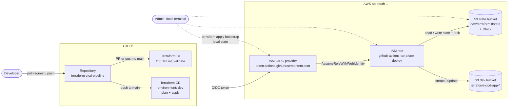

# Automated Terraform CI/CD Pipeline

> **Portfolio Project 02** of a 10-project DevOps and Cloud Engineering series.

A hands-on DevOps project that validates and deploys Terraform code automatically with GitHub Actions. GitHub Actions signs in to AWS with **OpenID Connect (OIDC)**, so no AWS access keys are stored in GitHub. Terraform state is kept in an encrypted, versioned **S3 bucket** and uses Terraform's native S3 state locking.


---

## Table of Contents

1. [Project Objectives](#1-project-objectives)
2. [Architecture Diagram](#2-architecture-diagram)
3. [How It Works](#3-how-it-works)
4. [Repository Structure](#4-repository-structure)
5. [Bootstrap Configuration](#5-bootstrap-configuration)
6. [Development Environment](#6-development-environment)
7. [GitHub Actions Workflows](#7-github-actions-workflows)
8. [OIDC Trust and IAM Permissions](#8-oidc-trust-and-iam-permissions)
9. [Remote State and Locking](#9-remote-state-and-locking)
10. [Prerequisites](#10-prerequisites)
11. [Setup Instructions](#11-setup-instructions)
12. [Verification](#12-verification)
13. [Security Considerations](#13-security-considerations)
14. [Cost Considerations](#14-cost-considerations)
15. [Cleanup](#15-cleanup)
16. [Known Limitations](#16-known-limitations)
17. [Future Improvements](#17-future-improvements)

---

## 1. Project Objectives

- Check Terraform formatting, linting and validation automatically on every pull request to `main`.
- Deploy infrastructure automatically when changes reach `main`.
- Authenticate GitHub Actions to AWS with short-lived OIDC credentials instead of stored access keys.
- Store Terraform state remotely in Amazon S3 with versioning, encryption and native state locking.
- Limit the deployment role to the state file and the one development bucket it manages.

## 2. Architecture Diagram

The editable source is in [`architecture/architecture.mmd`](architecture/architecture.mmd).



## 3. How It Works

The project has two Terraform configurations with different jobs:

| Configuration | Applied by | State | Creates |
|---|---|---|---|
| `bootstrap/` | An admin, once, from a local terminal | Local file (not committed) | S3 state bucket, GitHub OIDC provider, IAM deployment role and its policy |
| `environments/dev/` | GitHub Actions (CD workflow) | Remote, in the S3 state bucket | A development S3 bucket |

The bootstrap must exist before the pipeline can run, because the pipeline needs the state bucket and the IAM role. This is why bootstrap uses local state.

The pipeline flow:

1. A developer opens a pull request to `main`. The **CI** workflow checks formatting, runs TFLint and validates both configurations. It does not connect to AWS.
2. After the pull request is merged, the push to `main` runs CI again and, if files under `bootstrap/`, `environments/dev/` or the CD workflow changed, the **CD** workflow.
3. CD requests an OIDC token from GitHub and exchanges it for temporary AWS credentials for the `github-actions-terraform-deploy` role.
4. CD runs `terraform init`, `terraform plan` and `terraform apply` in `environments/dev`, using the remote state in S3.

## 4. Repository Structure

```text
terraform-cicd-pipeline/
├── README.md
├── .gitignore
├── .github/
│   └── workflows/
│       ├── terraform-ci.yml          # fmt, TFLint, validate on PRs and pushes to main
│       └── terraform-cd.yml          # OIDC login, plan and apply on pushes to main
├── architecture/
│   └── architecture.mmd              # Editable Mermaid diagram
├── bootstrap/
│   ├── main.tf                       # State bucket, OIDC provider, IAM role and policy
│   ├── variables.tf
│   ├── outputs.tf
│   ├── terraform.tfvars.example      # Placeholder values; copy to terraform.tfvars
│   └── .terraform.lock.hcl
└── environments/
    └── dev/
        ├── backend.tf                # S3 backend with native locking
        ├── main.tf                   # Development S3 bucket
        ├── variables.tf
        ├── outputs.tf
        └── .terraform.lock.hcl
```

Not committed (excluded by `.gitignore`): `terraform.tfvars`, `*.tfstate*`, `*.tfplan`, `.terraform/` directories, credentials and key files.

## 5. Bootstrap Configuration

| Resource | Terraform address | Details |
|---|---|---|
| State bucket | `aws_s3_bucket.terraform_state` | Name from `var.state_bucket_name` |
| Versioning | `aws_s3_bucket_versioning.terraform_state` | Enabled, so earlier state versions can be recovered |
| Encryption | `aws_s3_bucket_server_side_encryption_configuration.terraform_state` | SSE-S3 (`AES256`) |
| Public access block | `aws_s3_bucket_public_access_block.terraform_state` | All four settings `true` |
| OIDC provider | `aws_iam_openid_connect_provider.github` | `https://token.actions.githubusercontent.com`, audience `sts.amazonaws.com` |
| IAM role | `aws_iam_role.github_actions` | `github-actions-terraform-deploy`, trusted only through the OIDC provider |
| Inline policy | `aws_iam_role_policy.github_s3_access` | `github-terraform-s3-access` (see [Section 8](#8-oidc-trust-and-iam-permissions)) |

| Variable | Default | Description |
|---|---|---|
| `aws_region` | `ap-south-1` | Region for bootstrap resources |
| `state_bucket_name` | none | Globally unique state bucket name |
| `github_repository` | none | `owner/repository` |
| `github_environment` | `dev` | GitHub environment allowed to deploy |
| `github_owner_id` | none | Immutable numeric GitHub owner ID |
| `github_repository_id` | none | Immutable numeric GitHub repository ID |

Outputs: `terraform_state_bucket`, `github_oidc_provider_arn`, `github_actions_role_arn`, `development_bucket_name`.

## 6. Development Environment

`environments/dev` creates one S3 bucket named `terraform-cicd-app-<account-id>-<region>`:

| Resource | Terraform address | Details |
|---|---|---|
| S3 bucket | `aws_s3_bucket.dev` | Tagged `Environment = dev`, `Project = terraform-cicd-pipeline` |
| Versioning | `aws_s3_bucket_versioning.dev` | Enabled |
| Encryption | `aws_s3_bucket_server_side_encryption_configuration.dev` | SSE-S3 (`AES256`) |
| Public access block | `aws_s3_bucket_public_access_block.dev` | All four settings `true` |
| Ownership controls | `aws_s3_bucket_ownership_controls.dev` | `BucketOwnerEnforced` (ACLs disabled) |

| Variable | Default | Description |
|---|---|---|
| `aws_region` | `ap-south-1` | Region for the provider and the bucket name |

Outputs: `dev_bucket_name`, `dev_bucket_arn`, `aws_region`.

> The bucket name built here must match `local.dev_bucket_name` in `bootstrap/main.tf`, because the IAM policy only allows the role to manage that exact bucket.

## 7. GitHub Actions Workflows

### Terraform CI (`terraform-ci.yml`)

| Setting | Value |
|---|---|
| Triggers | Pull requests to `main`; pushes to `main` |
| Permissions | `contents: read` (no AWS access) |
| Terraform | `1.15.8` via `hashicorp/setup-terraform@v3` |

Steps: `terraform fmt -check -recursive`, `tflint --recursive`, then `init -backend=false` and `validate` for `bootstrap` and `environments/dev`.

### Terraform CD (`terraform-cd.yml`)

| Setting | Value |
|---|---|
| Triggers | Pushes to `main` that change `bootstrap/**`, `environments/dev/**` or the CD workflow; manual `workflow_dispatch` |
| Permissions | `contents: read`, `id-token: write` (required to request the OIDC token) |
| GitHub environment | `dev` |
| Concurrency | Group `terraform-dev-deployment`, no cancellation, so only one deployment runs at a time |
| AWS login | `aws-actions/configure-aws-credentials@v4` with `role-to-assume` |

Steps: `aws sts get-caller-identity`, `terraform init`, `terraform plan -out=tfplan`, `terraform apply tfplan`.

## 8. OIDC Trust and IAM Permissions

### Trust policy

The role can only be assumed with a GitHub OIDC token that has:

- audience (`aud`) `sts.amazonaws.com`, and
- subject (`sub`) exactly equal to:

```text
repo:<owner>@<owner-id>/<repository>@<repository-id>:environment:dev
```

This uses GitHub's [immutable subject claim](https://github.blog/changelog/2026-04-23-immutable-subject-claims-for-github-actions-oidc-tokens) format. It includes the numeric owner and repository IDs, which never change, so a deleted and re-created repository or account with the same name cannot assume the role. Only jobs that run in the `dev` GitHub environment match.

### Permissions policy

| Statement | Actions | Resource |
|---|---|---|
| `TerraformStateAccess` | `s3:ListBucket` | State bucket, prefix `dev/*` only |
| `TerraformStateObjects` | `s3:GetObject`, `s3:PutObject` | `dev/terraform.tfstate` |
| `TerraformStateLock` | `s3:GetObject`, `s3:PutObject`, `s3:DeleteObject` | `dev/terraform.tfstate.tflock` |
| `CreateDevBucket` | `s3:CreateBucket` | `arn:aws:s3:::*`, only in the configured region |
| `ManageDevBucket` | Bucket read, versioning, encryption, public access block, ownership and tagging actions | The development bucket only |
| `ManageDevBucketObjects` | `s3:GetObject`, `s3:PutObject`, `s3:DeleteObject` | Objects in the development bucket |

The role has no IAM, EC2 or other service permissions.

## 9. Remote State and Locking

`environments/dev/backend.tf`:

| Setting | Value |
|---|---|
| `key` | `dev/terraform.tfstate` |
| `region` | `ap-south-1` |
| `encrypt` | `true` |
| `use_lockfile` | `true` |

`use_lockfile = true` turns on Terraform's native S3 locking (Terraform 1.10+). While a run is active, Terraform writes `dev/terraform.tfstate.tflock` next to the state file, and a second run waits or fails instead of writing at the same time. No DynamoDB table is needed.

## 10. Prerequisites

| Requirement | Notes |
|---|---|
| AWS account | Permission to create S3 buckets, IAM roles, policies and OIDC providers (for bootstrap) |
| Terraform | `>= 1.10.0`; the workflows use `1.15.8` |
| AWS CLI v2 | For the local bootstrap apply and verification |
| GitHub repository | With Actions enabled |
| GitHub CLI (optional) | To look up the owner and repository IDs |

## 11. Setup Instructions

### Step 1: Apply the bootstrap locally

```powershell
cd bootstrap
Copy-Item terraform.tfvars.example terraform.tfvars    # Linux/macOS: cp terraform.tfvars.example terraform.tfvars
# Edit terraform.tfvars with your values
terraform init
terraform plan -out=bootstrap.tfplan
terraform apply bootstrap.tfplan
terraform output
```

Look up the numeric IDs for `terraform.tfvars`:

```powershell
gh api users/<github-owner> --jq .id
gh api repos/<github-owner>/terraform-cicd-pipeline --jq .id
```

### Step 2: Point the pipeline at your AWS resources

- In `environments/dev/backend.tf`, set `bucket` to the `terraform_state_bucket` output.
- In `.github/workflows/terraform-cd.yml`, set `role-to-assume` to the `github_actions_role_arn` output.

### Step 3: Create the GitHub environment

In the repository, open **Settings > Environments > New environment** and create `dev`. The name must match `github_environment`. Adding **Required reviewers** is recommended, so every apply waits for approval.

### Step 4: Use the pull request flow

```powershell
git checkout -b feature/my-change
# make changes
terraform fmt -recursive
git commit -am "Describe the change"
git push -u origin feature/my-change
```

Open a pull request to `main`, wait for **Terraform CI** to pass, then merge. **Terraform CD** runs on the push to `main`.

## 12. Verification

| Check | How |
|---|---|
| CI passed | **Actions** tab, workflow **Terraform CI** |
| CD signed in with OIDC | **Terraform CD** log, step **Verify AWS identity** shows the assumed role `github-actions-terraform-deploy` |
| State is remote | `aws s3 ls s3://<state-bucket>/dev/` lists `terraform.tfstate` |
| Development bucket exists | `aws s3api head-bucket --bucket terraform-cicd-app-<account-id>-ap-south-1` |
| Bucket settings | `aws s3api get-bucket-versioning`, `get-bucket-encryption` and `get-public-access-block` with `--bucket <dev-bucket>` |

## 13. Security Considerations

- **No long-lived AWS keys in GitHub.** Credentials are temporary and issued per workflow run through OIDC.
- **Narrow trust.** Only the `dev` environment of this specific repository, identified by immutable IDs, can assume the role.
- **Least privilege.** The role can only use the `dev/` state path and the one development bucket.
- **Read-only CI.** The CI workflow has `contents: read` and no AWS credentials, so pull request code cannot reach AWS.
- **Protected state.** The state bucket is versioned, encrypted and blocks all public access.
- **Nothing sensitive committed.** State, tfvars, plan files and the `.terraform/` directories are excluded by `.gitignore`.

## 14. Cost Considerations

This project uses only S3, IAM and GitHub Actions:

- IAM roles, policies and OIDC providers have no charge.
- S3 charges for storage and requests. State files and an empty bucket are very small, but versioning keeps every state version.
- GitHub Actions minutes are free for public repositories, and private repositories include a monthly allowance.

Check the [AWS Pricing Calculator](https://calculator.aws/) for current S3 prices in `ap-south-1`.

## 15. Cleanup

Destroy in reverse order: the development environment first, then the bootstrap.

```powershell
# 1. Development environment (uses the remote state)
cd environments/dev
terraform init
terraform destroy

# 2. Bootstrap (uses local state)
cd ../../bootstrap
terraform destroy
```

The state bucket is versioned and does not set `force_destroy`. If `terraform destroy` fails with `BucketNotEmpty`, delete all object versions and delete markers in the state bucket first (for example from the S3 console with **Empty**), then run `terraform destroy` again. After the state bucket is gone, the pipeline can no longer run until bootstrap is applied again.

## 16. Known Limitations

- **Account-specific values in code.** `backend.tf` and `terraform-cd.yml` contain the state bucket name and role ARN, which include the AWS account ID.
- **Bootstrap uses local state.** Losing `bootstrap/terraform.tfstate` means the bootstrap resources must be imported or managed by hand.
- **No plan on pull requests.** The role trusts only the `dev` environment, so CI cannot run `terraform plan` against AWS.
- **Automatic apply.** CD applies the plan with `-auto-approve`. Approval depends on the `dev` environment's protection rules in GitHub.
- **Broad bucket creation.** `s3:CreateBucket` is allowed on `arn:aws:s3:::*` (limited by region), not only on the development bucket.
- **Bootstrap changes trigger CD.** CD watches `bootstrap/**`, but it only applies `environments/dev`.
- **Single environment.** Only `dev` is defined.

## 17. Future Improvements

- Store the role ARN and state bucket in GitHub variables and pass the bucket with `-backend-config`.
- Add a read-only plan role trusted for pull requests, and post the plan as a pull request comment.
- Restrict `s3:CreateBucket` to the development bucket ARN.
- Remove `bootstrap/**` from the CD path filter, or add a separate bootstrap workflow.
- Add security scanning (for example `checkov`) to CI.
- Add `staging` and `prod` environments with separate state keys and roles.

---

*Hands-on learning project built to demonstrate practical Terraform, GitHub Actions and AWS skills.*
